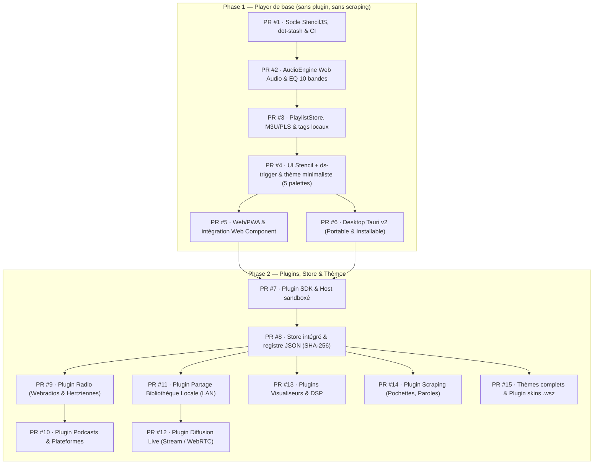

# Plan de développement mPlay3r — Découpage en PRs & Stratégie de Tests

> [!IMPORTANT]
> **Règle d'or pour chaque PR** : 1 tâche = 1 branche dédiée = 1 PR atomique et reviewable, avec ses **tests automatisés** (unitaires TS, composants Stencil, SCSS et/ou Rust) qui passent au vert sur la CI avant de passer à la suivante.  
> **Contrainte de poids** : le socle Phase 1 reste ultra-léger (zéro plugin, zéro scraping, zéro dépendance runtime hors `dot-stash`). Toutes les fonctionnalités avancées sont isolées en plugins téléchargeables en Phase 2.

---

## Vue d'ensemble du séquençage

---

## Phase 1 — Version de base (sans plugin, sans scraping)

### PR #1 — Socle projet, StencilJS + `dot-stash` & CI
- **Branche** : `chore/pr-01-project-setup`
- **Contenu** :
  - Configuration Node 22, StencilJS (`www/`, `dist/`, `dist/components/`, `loader/`), dépendance `dot-stash@0.2.0`, TypeScript, ESLint, Stylelint, Prettier.
  - Scripts de build SCSS (`scripts/build-css.mjs` branché sur `pkg:dot-stash/scss/engine`), dev runner (`scripts/dev.mjs`), hook TS pour `node --test`.
  - Workflows GitHub Actions (`ci.yml`), `README.md`, `docs/ARCHITECTURE.md`, `docs/ROADMAP.md`.
- **Tests inclus** :
  - Vérification CI : installation propre de `dot-stash`, compilation Sass `--strict` (0 warning), lint TS/SCSS, contrôle d'existence des 3 cibles de build.

### PR #2 — Moteur Core Audio (Web Audio API + EQ 10 bandes + Persistance)
- **Branche** : `feat/pr-02-audio-engine-eq`
- **Contenu** :
  - Types de base (`Track`, `EqualizerState`, `PaletteId`, `PlayerSnapshot`), constantes Winamp (10 bandes `60Hz..16kHz`, 14 presets, 5 palettes), formatage (`MM:SS`, temps restant, dB, balance).
  - `AudioEngine` : graphe Web Audio API paresseux (`Preamp → 10× BiquadFilterNode → StereoPanner → MasterGain → AnalyserNode`), lissage anti-clics, hooks Phase 2 (`getAnalyserNode`, `getAudioContext`).
  - Persistance sécurisée (`storage.ts` avec sanitization des valeurs hors bornes).
- **Tests inclus** :
  - `tests/format.test.ts` : temps écoulé/restant, durées > 1h, dB, balance, extensions.
  - `tests/audio-engine.test.ts` : graphe DSP complet (10 fréquences Winamp, presets, bypass On/Off sans perte des réglages, volume, mute, balance, seek, initialisation paresseuse de l'`AnalyserNode`).
  - `tests/storage.test.ts` : résilience aux données corrompues et clamping des bornes.

### PR #3 — Gestionnaire de Playlist, Import/Export M3U/PLS & Tags locaux hors-ligne
- **Branche** : `feat/pr-03-playlist-and-local-metadata`
- **Contenu** :
  - `PlaylistStore` : ajout, suppression, réordonnancement par IDs (`ds-sortable`), filtrage instantané, shuffle Fisher-Yates, repeat (`off` / `all` / `one`), comportement Winamp *Previous* (> 3 s relance la piste), révocation des `blob:` URLs.
  - `playlist-io.ts` : parseur/sérialiseur M3U / M3U8 (`#EXTINF`) et parseur PLS Winamp.
  - `metadata.ts` : extraction hors-ligne depuis le nom de fichier + lecteur binaire léger ID3v1 / ID3v2.3 / ID3v2.4 (**0 requête réseau**).
- **Tests inclus** :
  - `tests/playlist-store.test.ts` : navigation, shuffle, repeat `off`/`all`/`one`, *Previous* > 3 s, réordonnancement avec conservation de la piste active, nettoyage `blob:`.
  - `tests/playlist-io.test.ts` : M3U8, URLs relatives, PLS trié numériquement, round-trip complet.
  - `tests/metadata.test.ts` : noms de fichiers variés, frames ID3v2 UTF-8/UTF-16/Latin1, ID3v1, robustesse sur données invalides.

### PR #4 — Composants StencilJS (`dot-stash` + `ds-trigger`) & Thème minimaliste 5 palettes
- **Branche** : `feat/pr-04-ui-and-minimal-theme`
- **Contenu** :
  - `<mplay3r-app>` (Light DOM, 38 `@Method()` pilotables par `ds-trigger`, mode `headless`, raccourcis clavier Winamp, Drag & Drop, MediaSession API).
  - `<mp-header>`, `<mp-transport>`, `<mp-equalizer>` (faders verticaux `ds-range` + courbe SVG), `<mp-playlist>` (`ds-sortable` + recherche + actions `ds-trigger`).
  - Thème SCSS minimaliste (`scss/themes/minimal/`) compilé sur `pkg:dot-stash/scss/engine` avec 5 palettes scopées (`obsidian`, `slate`, `amber`, `emerald`, `sand`).
- **Tests inclus** :
  - Tests composants Stencil (`*.spec.tsx`) : vérification que chaque `<ds-trigger>` invoque la bonne `@Method()` sur `<mplay3r-app>`, bascule de palette scopée, rendu mode `headless`, synchronisation des contrôles EQ & Playlist, attributs ARIA.
  - Test de compilation Sass : vérification de la présence des tokens `--ds-*` et `--mp-*` pour les 5 palettes et absence de sélecteurs globaux intrusifs (`body`, `h1`) dans `minimal.css`.

### PR #5 — Version Web / PWA & Intégration Web Component externe
- **Branche** : `feat/pr-05-web-pwa-and-embed`
- **Contenu** :
  - Page standalone Web/PWA (`src/index.html`, `manifest.webmanifest`, `app.css`).
  - Page de démonstration d'intégration (`src/embed-demo.html`) : instances multiples sur la même page avec palettes différentes, pilotage depuis l'extérieur par `<ds-trigger>`, mode compact, générateur WAV de démo hors-ligne.
  - Vérification du budget de poids (taille JS/CSS gzippée contrôlée en CI).
- **Tests inclus** :
  - Test d'intégration multi-instances (zéro collision d'IDs entre deux `<mplay3r-app>`, pilotage externe par `<ds-trigger target="#...">`, attribut `tracks` JSON et URL `.m3u8`).
  - Check CI de budget de poids sur `dist/css/minimal.css` et les bundles `dist/`.

### PR #6 — Application Desktop Tauri v2 (Portable & Installable)
- **Branche** : `feat/pr-06-tauri-desktop`
- **Contenu** :
  - Backend Rust minimaliste (`src-tauri/`) optimisé taille (`opt-level = "s"`, `lto = true`, `strip = true`).
  - Protocole `mplay3r://` avec streaming HTTP `206 Partial Content` par blocs de 512 Ko (RAM constante même sur de gros FLAC) + liste blanche de sécurité (`AllowedPaths`).
  - Mode portable auto-détecté (`portable.flag`, `./data/`, ou `MPLAY3R_PORTABLE=1`) + dialogues OS natifs (fichiers, dossiers récursifs, M3U).
  - Workflow `.github/workflows/release.yml` (Windows portable `.zip` + installeurs Windows / Linux / macOS).
- **Tests inclus** :
  - Tests Rust (`cargo test`) : détection portable vs installé, parsing `Range` HTTP (ouvert, fermé, suffixe, invalide), MIME audio, refus des chemins non autorisés / path traversal, scan récursif de dossier.
  - `tests/desktop-bridge.test.ts` : détection runtime Web vs Tauri et appels IPC mockés.

---

## Phase 2 — Architecture Plugins, Store, Radios/Podcasts, Diffusion & Thèmes

> [!TIP]
> **Séparation des dépôts (validée)** :
> - **`jezoock/mPlay3r`** : SDK Plugins + Host sandboxé (PR #7) et Store intégré (PR #8).
> - **`jezoock/mPlay3r-addons`** : Registre JSON + tous les plugins et thèmes officiels (PR #9 à PR #15 + micro-plugins de radios par box FAI).

### PR #7 (`mPlay3r`) — SDK Plugins (`@mplay3r/plugin-sdk`) & Host sandboxé
- **Branche** : `feat/pr-07-plugin-sdk-and-host`
- **Contenu** :
  - Contrats TypeScript pour les 6 catégories de plugins : `source` (radios/podcasts/plateformes), `broadcast` (diffusion/partage), `visualizer`, `scraper`, `dsp`, `theme`.
  - `PluginHost` : cycle de vie (`install`, `enable`, `disable`, `uninstall`), permissions déclaratives (`audio-analyser`, `audio-context`, `network`, `local-server`, `ui-slot`, `theme`), isolation des erreurs, stockage portable/installé/IndexedDB.
  - Slots UI dédiés dans `<mplay3r-app>` (onglet/panneau plugin, zone visualiseur, zone info piste) toujours pilotables via `ds-trigger`.
- **Tests inclus** :
  - Tests unitaires du `PluginHost` (cycle de vie, refus d'accès hors permissions déclarées, isolation des exceptions d'un plugin, persistance de l'état activé/désactivé).

### PR #8 (`mPlay3r`) — Store intégré de plugins & Registre JSON vérifié (SHA-256)
- **Branche** : `feat/pr-08-plugin-store`
- **Contenu** :
  - Composant `<mp-store>` construit avec `dot-stash` : parcours par catégorie, recherche, fiche détaillée (poids en Ko, permissions, version), installation / mise à jour / suppression en 1 clic, ajout de registres tiers et import local `.zip`.
  - Connexion par défaut au registre JSON hébergé sur `jezoock/mPlay3r-addons` + vérification d'intégrité cryptographique **SHA-256** avant chargement.
- **Tests inclus** :
  - Tests de validation de manifestes, vérification SHA-256 (acceptation sur hash valide, rejet strict sur hash altéré), compatibilité de version `minCoreVersion`, tests composant `<mp-store>`.

### PR #9 (`mPlay3r-addons`) — Plugin #1 (Partie A) : Radios Web & Hertziennes + Micro-plugins par Box FAI
- **Branche** : `feat/pr-09-plugin-radio`
- **Contenu** :
  - **Plugin Radio principal (simple & léger)** : annuaire ouvert **Radio Browser** (40 000+ stations incluant les radios hertziennes FM/DAB+ diffusées en IP), recherche par nom/pays/genre, favoris, URL directe, flux Icecast/SHOUTcast + **HLS (`.m3u8`)** lazy-loadé, affichage `LIVE`, reconnexion automatique et métadonnées **ICY (`StreamTitle`)**.
  - **Architecture extensible par box FAI** : contrat `RadioProvider` permettant d'installer un **micro-plugin dédié par box** (ex. `radio-freebox` via la playlist multiposte Freebox, `radio-bbox`, `radio-livebox`, `radio-sfr`) afin de n'embarquer que les flux correspondant à la box de l'utilisateur.
- **Tests inclus** :
  - Tests unitaires : parsing ICY, mapping Radio Browser, état `LIVE` (reconnexion backoff, désactivation seek), favoris, et tests du premier micro-plugin box (ex. parsing playlist Freebox multiposte + filtrage des flux radio).

### PR #10 (`mPlay3r-addons`) — Plugin #1 (Partie B) : Podcasts & Plateformes de streaming
- **Branche** : `feat/pr-10-plugin-podcasts`
- **Contenu** :
  - Recherche d'émissions via **Podcast Index / iTunes Search** + résolution des liens de plateformes de streaming vers le flux RSS audio ouvert correspondant.
  - Parseur RSS/Atom podcast (épisodes, durées, notes, chapitres), gestion d'abonnements, reprise automatique de la position d'écoute par épisode, contrôle de vitesse (`0.75×` à `2×`), sauts rapides `-15s / +30s`, téléchargement hors-ligne d'épisodes.
  - Interface extensible `MediaSourceProvider` permettant d'ajouter des connecteurs vers des serveurs/plateformes ouverts (ex. Subsonic/Navidrome, Audius, SoundCloud public).
- **Tests inclus** :
  - Tests unitaires : parseur RSS/Atom (formats iTunes, durées `HH:MM:SS` et secondes, encodages, flux incomplets), reprise de position par épisode, contrôle de vitesse et sauts temporels, résolution de liens.

> [!NOTE]
> Concernant les plateformes de streaming propriétaires protégées par DRM (ex. catalogues musicaux payants Spotify/Apple Music/Deezer), leurs flux audio ne peuvent pas être extraits directement sans SDK officiel et compte abonné. Pour les **podcasts publics** présents sur ces plateformes, le plugin résout leur flux RSS ouvert ; pour la musique en streaming, l'architecture `MediaSourceProvider` permet de brancher proprement des sources ouvertes ou les SDK officiels autorisés.

### PR #11 (`mPlay3r-addons`) — Plugin #2 (Partie A) : Partage de la bibliothèque locale (Serveur LAN + Client)
- **Branche** : `feat/pr-11-plugin-library-share`
- **Contenu** :
  - **Serveur de partage LAN (Desktop Tauri)** : micro-serveur HTTP activé manuellement exposant **uniquement** les dossiers musicaux choisis par l'utilisateur, avec authentification par **PIN / Bearer token**, QR code de connexion rapide et streaming HTTP `206 Range`.
  - **Interface web servie automatiquement** : n'importe quel téléphone ou PC du réseau ouvre l'URL locale et accède directement à un lecteur `<mplay3r-app>` embarqué connecté à la bibliothèque partagée.
  - **Client distant** dans `mPlay3r` (Web & Desktop) pour se connecter à une autre instance `mPlay3r` partagée et parcourir/lire ses dossiers et playlists.
- **Tests inclus** :
  - Tests Rust de sécurité et réseau : refus HTTP 401 sans token valide, protection anti path-traversal (`../`), streaming `Range`, respect strict de la liste blanche de dossiers.
  - Tests TypeScript : client API distante, navigation dossiers, pagination/recherche et gestion perte de connexion.

### PR #12 (`mPlay3r-addons`) — Plugin #2 (Partie B) : Diffusion audio en direct (Live Stream / Listening Party)
- **Branche** : `feat/pr-12-plugin-live-broadcast`
- **Contenu** :
  - **Mode Desktop (LAN / reverse-proxy)** : diffusion live de la lecture en cours (flux audio HTTP + synchronisation temps réel SSE piste/position/pause pour écoute synchronisée multi-auditeurs, compteur d'auditeurs, protection par token) + option d'envoi vers un serveur Icecast existant.
  - **Mode Web (P2P sans serveur média)** : diffusion audio temps réel via **WebRTC** en capturant la sortie du graphe Web Audio (`getAudioContext()` → `MediaStreamAudioDestinationNode`).
- **Tests inclus** :
  - Tests de synchronisation hôte/auditeur (play, pause, seek, changement de piste, compensation de latence), validation des tokens de session, mocks WebRTC/SSE et fermeture propre des flux.

### PR #13 (`mPlay3r-addons`) — Plugins Visualiseurs (Canvas 2D / WebGL / GLSL) & Effets DSP
- **Branche** : `feat/pr-13-plugin-visualizers-dsp`
- **Contenu** :
  - Pack de visualiseurs légers branchés sur `getAudioAnalyser()` : Analyseur de spectre Winamp, Oscilloscope minimaliste, Shader WebGL réactif audio, mode plein écran.
  - Exemple de plugin DSP `AudioWorklet` (ex. Bass Enhancer / Stereo Widener) démontrant le chaînage sur `getAudioContext()`.
- **Tests inclus** :
  - Tests unitaires des calculs FFT / peak-hold / décroissance, tests cycle de vie (`mount`, `resize`, `unmount` sans fuite `requestAnimationFrame`), tests bypass DSP.

### PR #14 (`mPlay3r-addons`) — Plugin Scraping Métadonnées (Pochettes, Paroles, Bio)
- **Branche** : `feat/pr-14-plugin-scraper`
- **Contenu** :
  - Enrichissement 100 % optionnel déclenché sur `mpTrackChange` : pochettes HD (MusicBrainz + Cover Art Archive), paroles synchronisées `.lrc` (LRCLIB), cache local persistant, requêtes natives sans CORS côté Desktop (Rust) et APIs CORS-friendly côté Web, écriture optionnelle des tags dans les fichiers locaux sur Desktop.
- **Tests inclus** :
  - Parseur `.lrc` (horodatages multiples, recherche de la ligne active), normalisation des requêtes artiste/titre, gestion du cache, du rate-limit et du mode hors-ligne.

### PR #15 (`mPlay3r-addons`) — Thèmes à refonte complète d'interface & Plugin Import Skins Winamp `.wsz`
- **Branche** : `feat/pr-15-themes-and-wsz-plugin`
- **Contenu** :
  - Moteur de thèmes structuraux exploitant `<mplay3r-app headless>` + `ds-trigger` (ex. thème complet *Winamp Classic 2.x* et thème *Hi-Fi Rack*).
  - **Plugin `.wsz`** : chargement local ou depuis le store d'archives Winamp `.wsz` (ZIP), extraction des sprites BMP (`main.bmp`, `cbuttons.bmp`, `eqmain.bmp`, `pledit.txt`, `viscolor.txt`) et rendu interactif piloté par `ds-trigger`.
- **Tests inclus** :
  - Parseur `pledit.txt` / `viscolor.txt`, décompression et mapping de sprites `.wsz` (archive complète + gestion gracieuse d'archives partielles/corrompues), changement de thème à chaud sans coupure audio.
